# boba

<p align="center">
  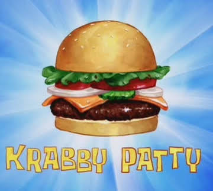
</p>

do not turn the sound on. nobody knows who recorded the sizzle. the guy who made the drone audio does not work here anymore and he refuses to answer emails.

<p align="center">
  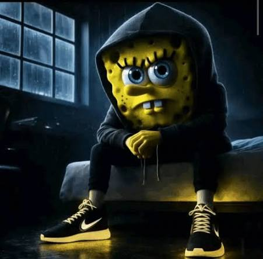
</p>

he has been sitting on that mattress since 2011. he owes me twelve dollars.

---

### tuesday

<p align="center">
  
  
  
  
  
</p>

the shells are wet. they dont even fire. he just holds it because it makes him feel included.

---

<p align="center">
  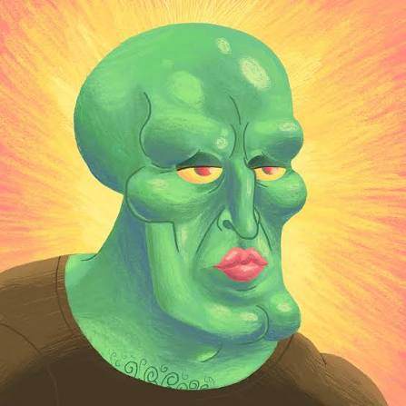
</p>

my cousin looks like this after two beers. nobody invited him. he just showed up through the sliding glass door.

---

### why is he running

<p align="center">
  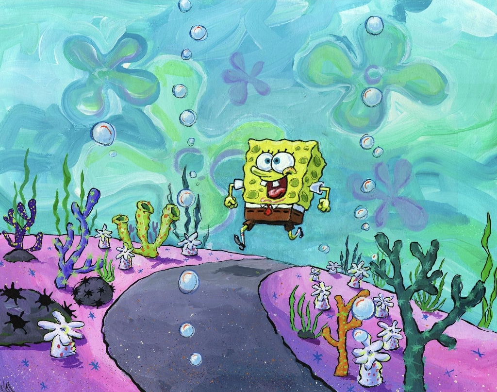
  
  
  
  
</p>

there is no road. where is he going. stop him.

---

<p align="center">
  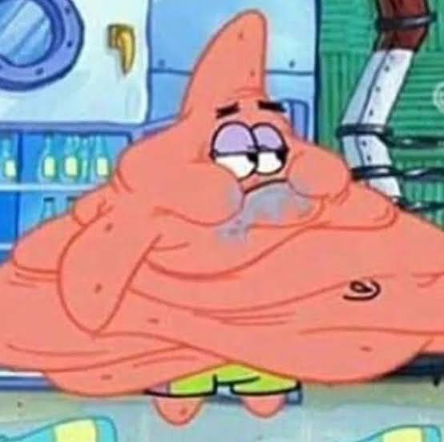
  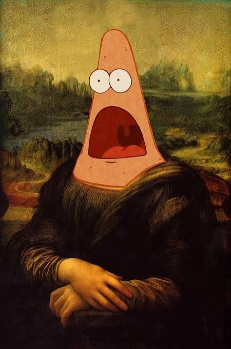
  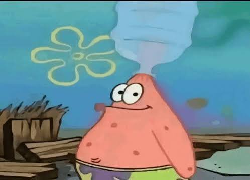
</p>

| left | middle | right |
| :---: | :---: | :---: |
| 74° outside | the louvre called they dont want it | he drank the whole thing in one gulp |

---

### the meatball incident

<p align="center">
  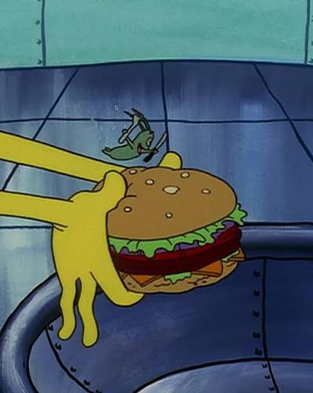
  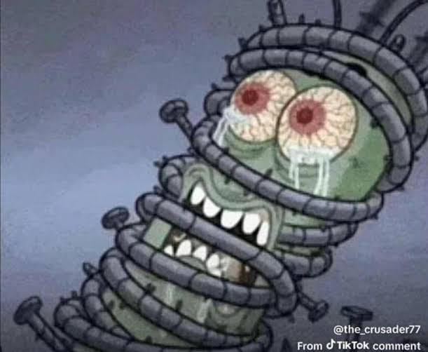
  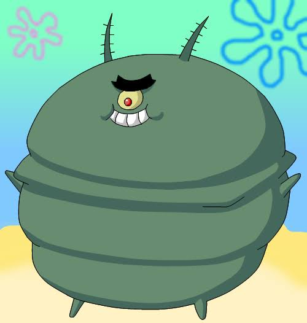
  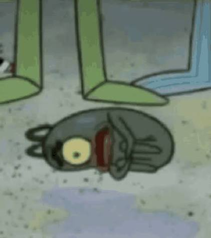
</p>

we told him not to swallow it whole. he didnt listen. now he is round. 20 minutes later someone stepped on him. he is fine now but he makes a whistling sound when he breathes.

---

### unprovoked

<p align="center">
  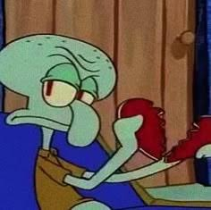
  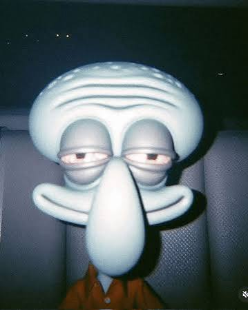
  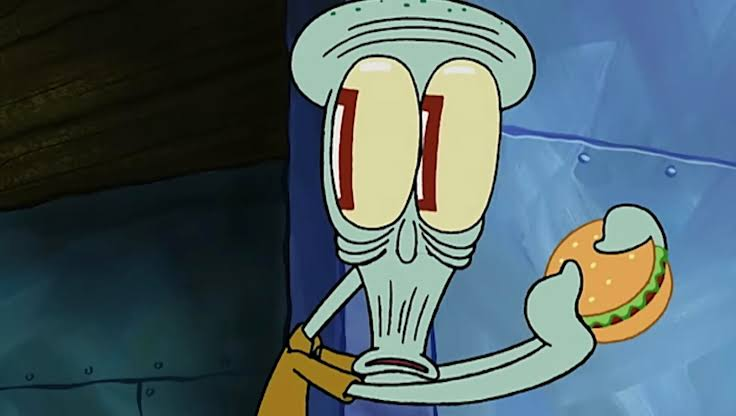
</p>

found him behind the dumpster at 4am chewing on an old receipt. when i tapped on the window he just stared like that for eleven minutes without blinking.

---

<p align="center">
  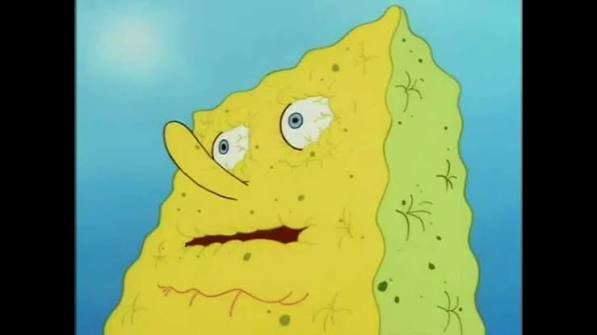
</p>

#### me when

<p align="center">
  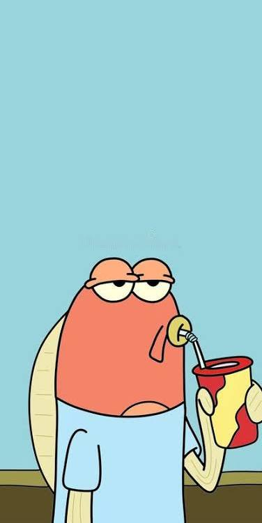
</p>

#### him when

---

### things found under the stove

<p align="center">
  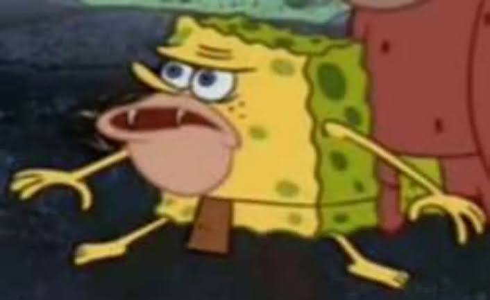
  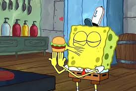
  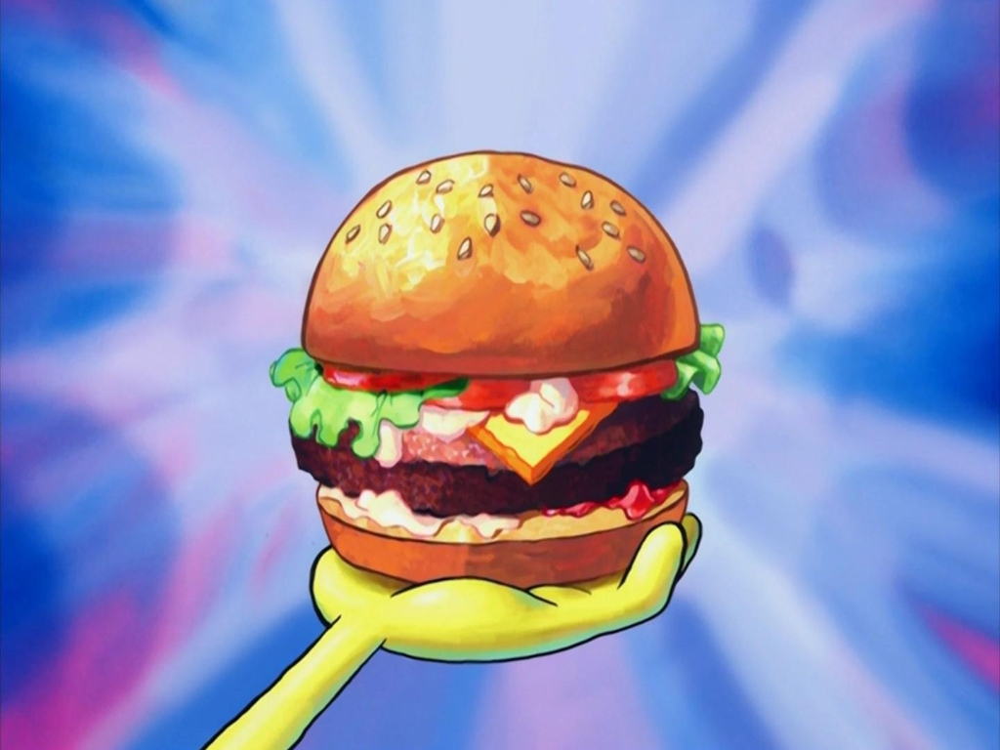
  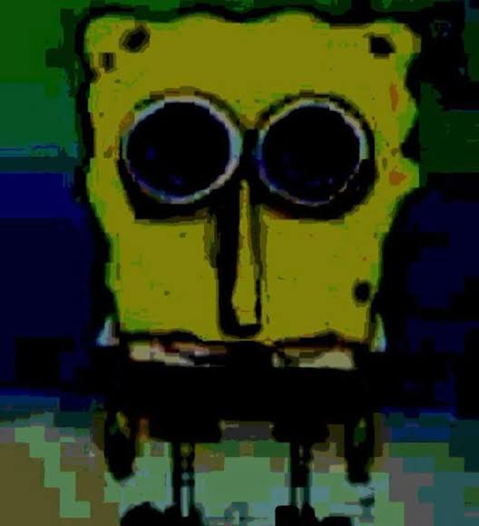
</p>

none of these are edible. one of them bit greg. greg is at urgent care.

---

<p align="center">
  
  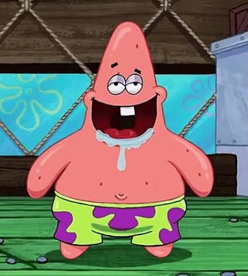
  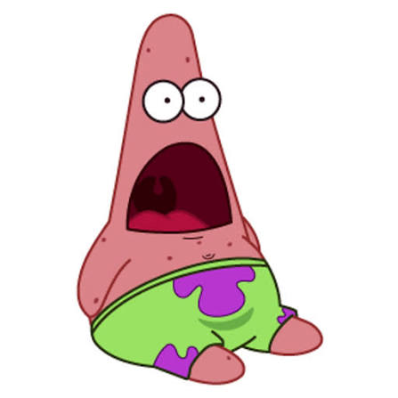
  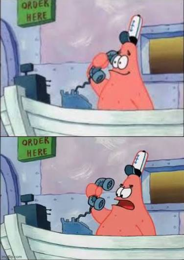
  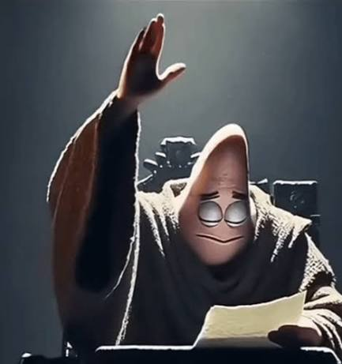
  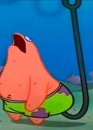
</p>

he has 6 moods and all of them are concerning.

---

### list of people who asked

<p align="center">
  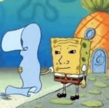
</p>

it is blank on the back.

---

```
how to run:
right click index.html -> open with live server
or literally just double click index.html

or dont. see if i care.
```

<p align="center">
  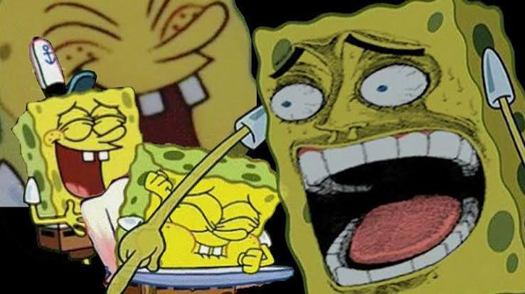
  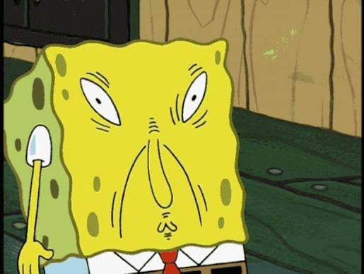
  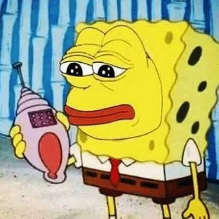
</p>

<p align="center">
  <sub>if you scroll down in the website it goes nowhere because it starts at the bottom. why would you scroll down. think.</sub>
</p>
